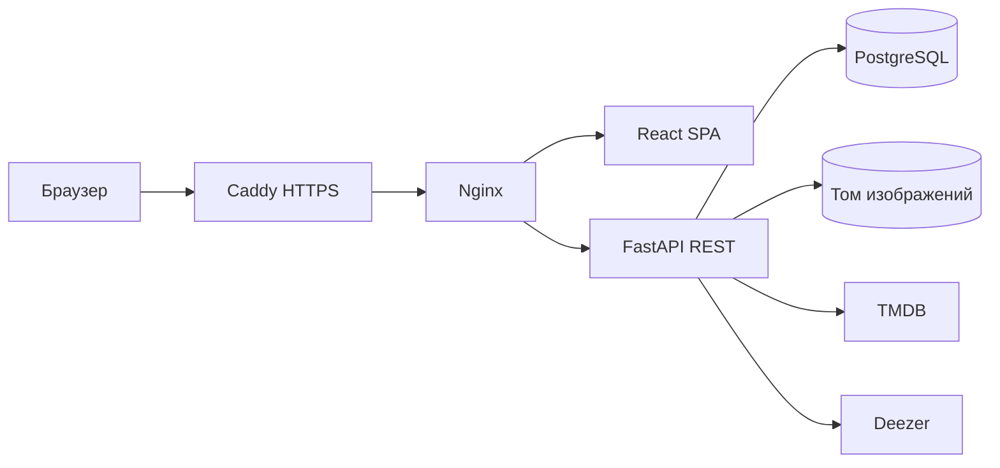

# Материалы курсовой работы Relay

Проект реализует веб-приложение для тематических коллекций из треков, фильмов и изображений. Исходные требования находятся в [техническом задании](../tz_mediaboard/ТЗ_Саруханян_А.А._Relay.pdf). Команды запуска и эксплуатации приведены в [README](../README.md).

## Матрица требований

| Требование ТЗ | Экран или операция | Способ проверки |
|---|---|---|
| 5.1.1.1 · публичная лента, доска, профиль и поиск | `/`, `/b/:key`, `/u/:username`, `/search` | Гостевой просмотр. Скрытая доска пропадает из выдачи |
| 5.1.1.1–2 · регистрация, вход, выход, профиль | `/register`, `/login`, `/u/:username`; `/api/v1/accounts`, `/api/v1/sessions` | Регистрация, cookie с ограниченным сроком, редактирование аватара и описания, выход |
| 5.1.1.2 · создание, удаление, обложка, видимость | `/new`, `/b/:key/edit` → «Настройки» | Гость, владелец, приглашённый редактор, посторонний. Устаревшая ссылка |
| 5.1.1.2 · три вида медиа | «Добавить» в редакторе | Найти трек и фильм. Добавить JPEG/PNG/WebP с диска или по HTTPS-ссылке |
| 5.1.1.2 · заметка, теги, порядок, перенос | Карточка в редакторе, `PUT /boards/:key/order`, `POST /boards/:key/items/:id/move` | Перестановка, конфликт версий, перенос в подходящую доску |
| 5.1.1.2 · фильтр и превью | Фильтры на доске, аудиофрагмент на карточке | Сброс фильтров, один активный трек, переход к источнику |
| 5.1.1.2 · подписки, рекомендации, лайки, комментарии | `/following`, профиль, карточка и комментарии | Повторный лайк и подписка, уведомления, удаление своего комментария |
| 5.1.1.2 · сохранение элемента | Кнопка закладки на карточке | Копия остаётся после удаления исходного элемента |
| 5.1.1.2 · приглашения, уведомления, жалобы | «Редакторы» в настройках, `/notifications`, «Пожаловаться» | До принятия доступа нет. После отзыва файлы и содержимое опять закрыты |
| 5.1.1.3 · модерация и статистика | `/admin`, `/api/v1/admin` | Жалоба, решение, журнал, блокировка с отзывом сессий, статистика |
| 5.1.4 · 100 одновременных запросов, поиск и 500 элементов | `scripts/load.py`, тесты PostgreSQL, живой каталог | Зафиксировать стенд, p95, максимум, ошибки и время внешнего поиска |
| 5.2 · валидация, целостность, отказ и восстановление | Pydantic, транзакции SQLAlchemy, проверка Pillow, Alembic, `scripts/backup.sh` и `scripts/restore.sh` | Некорректный файл, закрытый файл, повторный запрос, восстановление дампа и содержимого тома |
| 5.4–5.6 · развёртывание и интерфейс | Compose, Caddy, OpenAPI, адаптивный React | Проверка HTTPS и браузеров на целевом стенде, в том числе ширина 360 px |

## Права доступа

| Действие | Гость | Пользователь | Редактор | Владелец |
|---|---|---|---|---|
| Читать публичную доску | Да | Да | Да | Да |
| Открыть доску «По ссылке» | По адресу публикации | По адресу публикации | Да | Да |
| Читать приватную доску и файлы | Нет | Нет | После принятия | Да |
| Лайк, комментарий, жалоба | Нет | На доступной доске | Да | Да |
| Сохранить элемент себе | Нет | С доступной доски | Да | Да |
| Добавить, переставить, перенести | Нет | В своей доске | На доступных для правки досках | На доступных для правки досках |
| Менять видимость, участников, обложку и удалять доску | Нет | В своей доске | Нет | Да |

Административные операции имеют отдельный набор маршрутов и записываются в журнал. Роль администратора сама по себе не даёт доступ к приватной доске через пользовательский маршрут.

## Схема работы

Доской владеет пользователь. Один объект `Media` участвует во многих `Item`. Связь `Item` содержит положение, заметку и теги. Изменения порядка сериализуются блокировкой строки `Board` и сравнивают версию запроса с версией в базе. При переносе две строки досок блокируются в порядке идентификаторов. Файл принадлежит медиаобъекту, а выдача проверяет доступ к доске и вхождение объекта через конкретный элемент.

## Аналоги и выбор стека

| Аналог | Изученное взаимодействие | Применение к Relay |
|---|---|---|
| Pinterest | Визуальные доски, сохранение, секретные и совместные доски | Сетка обложек, переход к составу коллекции |
| Letterboxd | Учет фильмов и тематические списки | Карточка фильма с годом, режиссёром и ссылкой |
| Spotify и Last.fm | Плейлисты и профиль музыкальных интересов | Упорядочивание треков, превью и исполнитель |
| Are.na | Разнотипные блоки, авторский порядок, приглашённые редакторы | Общая доска с тремя типизированными карточками |

Источники описаний — [Pinterest Help](https://help.pinterest.com/en/article/create-a-board), [Spotify Support](https://support.spotify.com/us/article/create-playlists/), [Are.na Help](https://help.are.na/docs/getting-started/channels) и обзор аналогов в ТЗ.

React поддерживает единообразные состояния на страницах и в редакторе. Схема FastAPI фиксирует маршруты и ограничения входных данных. PostgreSQL обеспечивает ограничения, транзакции и блокировки строк. Постоянный том подходит для одного сервера из ТЗ и копируется вместе с БД. Формат каталога переведён в модель Relay при добавлении элемента.

## Комплект и приёмка

Результаты запусков приведены в [протоколе](acceptance.md), а сценарий работы и выступления в [руководстве](defense.md). Перенос результатов на кафедральный стенд и фиксация трудозатрат выполняются по журналу разработки. Для оценки эксплуатационных расходов подставьте выбранный тариф сервера, объём резервных копий и цену хранения. Оценка плана в 150–180 часов служит плановым ориентиром.

Полный [комплект курсовой](coursework/Комплект%20курсовой%20Relay.zip) включает записку на 27 страницах, восемь листов А1, копии А3 и А4, техническое задание, руководство и листинг.
